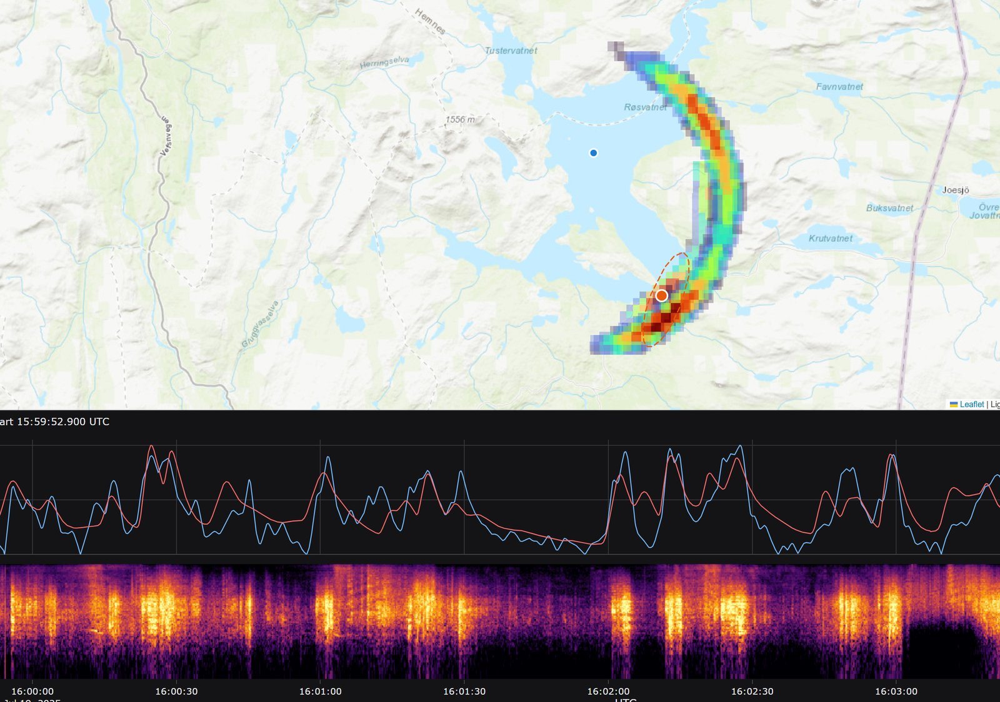

# lightning-rs

[](https://github.com/Hexay/lightning-rs/actions/workflows/ci.yml)
[](LICENSE)

Work out where and when an audio recording was made using only the thunder in it.



Lightning networks log every strike with millisecond timing and positions accurate to a few hundred metres.
Each strike's thunder reaches a listener after a delay set by distance. A recording of a storm therefore
carries the listener's position, as the delay pattern across dozens of strikes. lightning-rs searches a
day of strikes from [MET Norway's Frost API](https://frost.met.no) for the place and start time whose
predicted thunder best matches the recording. It outputs a probability map with a 90% credible region.

The output is a self-contained HTML page, shown above for a real 4-minute recording from northern Norway. The map
shows the posterior heatmap and the best candidate with its 90% ellipse. The panel below it plots modeled (red) against
observed (blue) thunder over UTC time, above a spectrogram of the clip.

## Install

Requirements:

- Rust (stable, edition 2024)
- [`ffmpeg`](https://ffmpeg.org) on `PATH` to decode audio. Any format ffmpeg reads works.
- A free Frost client ID from [frost.met.no](https://frost.met.no/howto.html), in a `.env` file at the repo root:

  ```
  FROST_CLIENT_ID=your-client-id
  ```

Then build:

```sh
git clone https://github.com/Hexay/lightning-rs
cd lightning-rs
cargo build --release
```

## Quickstart

You don't need a real recording to try it. `sim` synthesises thunder from real strikes at a listener you
choose, and you can then check whether `locate` finds that listener:

```sh
B=target/release/lightning-rs

$B sim --date 2025-07-19 --lat 65.089 --lon 19.339 --start 14:40:30 \
  --temp=12 --wind-e=4 --wind-n=4 --noise 0.03 --seed 25 --out data/sim/demo
$B locate --audio data/sim/demo/audio.wav --date 2025-07-19 --out out/demo
$B eval --run out/demo --truth data/sim/demo/truth.toml
```

`eval` should report an error of about 0.4 km. Open `out/demo/index.html` to see the map, with modeled and
observed thunder and a spectrogram underneath it. Lightning for each UTC day is downloaded once and cached in `data/frost/`.

## Python

```sh
pip install lightning-rs
```

The wheel bundles the compiled binary, so Rust isn't needed. ffmpeg still has to be on `PATH`.

```python
import lightning_rs as lr

res = lr.locate("storm.opus", "2025-07-19", frost_client_id="...")  # or set FROST_CLIENT_ID
res.best            # Region(rank=1, lat=65.659, lon=14.117, start=datetime(...), reliable=True, ...)
res.regions         # all candidates, best first
env = res.envelope()        # .times (UTC datetimes), .observed, .modeled
res.spectrogram             # .freqs_hz, .offsets_s, .power[band][frame]
res.viewer                  # path to the interactive HTML map
res.geopackage              # path to result.gpkg for ArcGIS / QGIS (geopandas.read_file(res.geopackage, layer="cells"))

# Your own lightning data: a CSV path, a list of dicts, or a pandas DataFrame
res = lr.locate("storm.opus", "2023-06-02", strikes=df)  # columns: time, lat, lon[, peak_ka, cloud, error_km]

lr.simulate("2025-07-19", 65.089, 19.339, "14:40:30", "sim/", temp=12, seed=25)  # synthetic test clip
lr.load("out/run")          # re-read a previous run
```

Frost downloads are cached in the user cache directory. To use a different location, set `LIGHTNING_RS_CACHE`.

## Usage

| Command | What it does |
|---|---|
| `locate --audio F --date D [--start HH:MM:SS]` | Searches every strike on UTC day `D` for where and when `F` was recorded. If you know the start time, `--start` narrows the search to ±0.5 s. |
| `eval --run DIR --truth T` | Scores a finished run against a truth file (`lat`/`lon` TOML). |
| `sim --date D --lat .. --lon .. --start ..` | Writes a synthetic `audio.wav` and `truth.toml`. Run `--help` for noise, wind, stereo and propagation options. |
| `fetch --date D` | Downloads and caches one day of Frost lightning ahead of time. |
| `probe ...` | Diagnostics: scores one point at every pipeline stage. |

`locate`, `sim` and `probe` take `--strikes file.csv` to use lightning data from any network instead of Frost:

| Column | Required | Meaning |
|---|---|---|
| `time` | yes | UTC, as epoch seconds or ISO-8601 (`2025-07-19T16:00:01.25Z`) |
| `lat`, `lon` | yes | Strike position, in degrees |
| `peak_ka` | no | Peak current in kA. Default 10. |
| `cloud` | no | `1`/`true` for in-cloud, otherwise cloud-to-ground |
| `error_km` | no | Location error, as a 50% radius. Default 0.5. |

Accuracy depends on the network's timing and position errors. Frost/NORDLIS reaches about 200 m; Blitzortung's
public feed is about 3 km.

`locate` writes five files to `--out` (default `out/run`):

- `index.html`: the map viewer. Under the map, it plots the modeled and observed thunder envelopes over UTC time, with a 10–1000 Hz spectrogram on the same time axis. Clicking a candidate region switches the modeled curve to that region.
- `result.gpkg`: a GeoPackage for ArcGIS Pro or QGIS (drag it in), in WGS 84. It has four layers:
  - `cells`: posterior grid polygons
  - `candidates`: points
  - `ellipses`: 90% regions, linked to candidates by `rank`
  - `onsets`: onset-solve fixes
- `heatmap.geojson`: the same features in a single GeoJSON file
- `candidates.json`: ranked regions, each with its start time, fitted atmosphere, 90% area and a `reliable` flag
- `trace.json`: the envelope curves and spectrogram shown in the viewer

### Models and overrides

- **`--model improved`** (the default) is the model described below.
- **`--model baseline`** reimplements the method from the video that inspired this project (see [Prior art](#prior-art)). It's there for comparison.
- **`--overrides file.toml`** overrides search settings. The fields are declared in [`src/config.rs`](src/config.rs) and [`experiments/`](experiments) has examples.

## How it works

1. **Observed envelope.** The audio is band-passed to 20–250 Hz, where thunder carries far and through walls. It's then reduced to a smoothed, compressed loudness envelope.
2. **Predicted envelope.** For a candidate listener position, every strike is rendered as a thunder pulse.
   - Cloud-to-ground strikes are modelled as extended vertical channels, intra-cloud strikes as horizontal sources aloft.
   - Arrival time is slant distance divided by the speed of sound, corrected for wind.
   - Loudness scales with peak current and falls off with range.
   - Each pulse has a rumble tail whose length grows with the channel's spread of arrival times.
3. **Match.** The predicted envelope is correlated with the observed one at every possible start time in the day, using FFT cross-correlation.
4. **Search, coarse to fine.** A coarse grid covers the whole strike region, then mid and fine grids refine the best peaks.
   - The fine stage marginalises over nuisance atmospheres: temperature (speed of sound), wind, refraction lapse rate and the effective height thunder onsets are timed from.
5. **Posterior.** Scores are tempered into a posterior, from which the tool reports ranked regions and 90% credible ellipses. A region is marked unreliable when fewer than 30 strikes would have been audible from it.

Two physical findings drove the model. Both are written up in [`research/`](research):

- **CG onset height.** Real thunder onsets behave as if they come from about 6 km up, not from the channel base (see [empirical_thunder_response.md](research/empirical_thunder_response.md)).
- **Refraction shadow.** Upward refraction hides the low part of distant channels (see [thunder_physics_lit.md](research/thunder_physics_lit.md)).

## Accuracy and limitations

| Case | Error |
|---|---|
| Synthetic clips, listener near active storms | 0.4–1.0 km |
| Synthetic twin of the real clip | 1.4 km |
| Real 4-minute recording, northern Norway | 1.3 km, versus 2.2 km for the baseline method. Not blind: the truth was known during development. |

Limitations:

- **Coverage.** Frost lightning covers the Nordic detection network (Norway and neighbouring countries) and nothing else. For anywhere else, use `--strikes` with data from another network.
- **Recording length.** You need several minutes of unedited audio recorded inside an active storm. Short or edited clips don't hear enough strikes to fix a position.
- **Geometry.** If every strike comes from one direction, the result is a stretched ellipse. Strikes from several directions give a tight fix.
- **Video clocks.** In a video, the visible flashes give the frame clock. The audio track can be seconds away from that, so `--start` taken from flashes needs care.
- **Real clips fit worse than simulations.** The model is still incomplete, and the credible regions on real audio should be read as optimistic.

## Prior art

- The baseline method comes from colsto's videos [*Can you geolocate a video using background thunder sounds?*](https://www.youtube.com/watch?v=SnbkIm56TfI) and [*I located a fan's video using thunder sounds*](https://www.youtube.com/watch?v=6a7Z0I3LAnE). The method is a point source, 343 m/s, inverse-square attenuation and cosine similarity.
- Related work on timing and locating recordings is surveyed in [`research/prior_art_receiver_location.md`](research/prior_art_receiver_location.md).

## Data and attribution

- **Lightning data:** from [MET Norway](https://www.met.no) via the [Frost API](https://frost.met.no), licensed under [NLOD 2.0 / CC BY 4.0](https://www.met.no/en/free-meteorological-data/Licensing-and-crediting). Raw strike files are not redistributed here; each user downloads them with their own client ID.
- **Map tiles in the viewer:** © Esri, HERE, Garmin and © OpenStreetMap contributors.

## License

[MIT](LICENSE)
